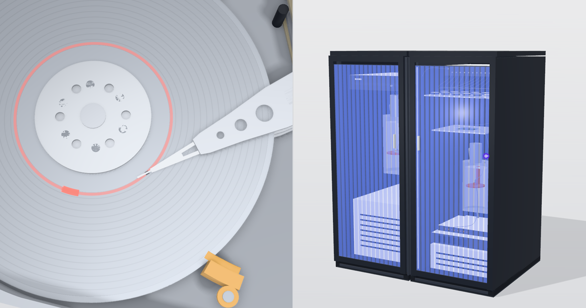

# Exploded

Real machines, built from code with their real numbers, that you can take apart in the browser. Every gauge reads
the same model that moves the parts. Left alone, each page plays a guided tour; any click hands control over.

**Live:** <https://exploded.storagebits.workers.dev> (English, French, Spanish).



## The machines

| | The machine | What drives it | Checked by |
|---|---|---|---|
| [**Quantum**](machines/quantum) | A photonic quantum computer: a quantum dot emits one photon per laser pulse, fibre delay lines bring them onto a 24-mode chip together, 276 Mach-Zehnder interferometers mix them, superconducting detectors click. A Hong-Ou-Mandel test on one coupler, the Perceval program behind the heaters. Modelled on the public figures of Quandela's Belenos; not affiliated with Quandela. | The physical time τ of the shot, in nanoseconds. The output distribution is computed from the permanents of the chip's unitary. | `machines/quantum/check.mjs` |
| [**Spindl**](machines/spindl) | A 3.5-inch 7,200 rpm desktop hard drive (2 platters, 4 heads): spin-up, the heads loading off the ramp, a seek drawn live, the rotational wait, the 3 nm flying height, the emergency park. A model of a typical drive, not a specific product. | The drive time τ. A request queue (LBA → zone, cylinder, head, sector) is planned once. | `machines/spindl/check.mjs` |

Spindl was first published on its own at <https://spindl.storagebits.workers.dev>
([algotitanhq/spindl](https://github.com/algotitanhq/spindl)); it carries on here.

Each machine has a `REFERENCES.md` (the sources of its numbers and of its geometry) and a `FILM.md` (how its tour is
recorded as a video, with its sound).

## Build

```sh
npm ci
npm run check     # the figures of every machine, the root language choice
npm run build     # dist/: the gallery and one self-contained page per machine and language (< 1 MB each)
ONLY=quantum npm run build    # one machine and the gallery
```

Open `dist/en/quantum/index.html` directly, or any page with `?lang=fr` / `?lang=es`.

## Layout

| Path | What it holds |
|---|---|
| `machines/<slug>/` | One machine: `*-shared/` (the model, the geometry, the console, the tour, the live page, its words in three languages), `*-film/` and `*-live/` (the two entry points), `check.mjs`, `REFERENCES.md`, `FILM.md`, `og.png`. |
| `shared/` | What every machine shares: the languages and the number format (`i18n.js`), the page's header and footer (`chrome.js`). |
| `scripts/machines.mjs` | The collection: each machine's name, entry point and page titles; the gallery's words. |
| `scripts/build.mjs` | The site build. |
| `kit/` | The teardown kit's runtime (MIT, `kit/LICENSE`). |
| `worker/` | The root's language redirect. |

### Adding a machine

1. Build it with the teardown skill, in `machines/<slug>/`: `<name>-shared/`, `<name>-film/main.js`, `<name>-live/main.js`.
   Import the kit as `teardown-kit/…`.
2. Give it an `i18n.js` built with `makeT()` from `shared/i18n.js`, every word through it, and call
   `createChrome({slug, name, credit})` from `shared/chrome.js` in its live page.
3. Add a `check.mjs` that recomputes its figures, and add it to `npm run check`.
4. Add it to `scripts/machines.mjs`, with an `og.png` (1200 × 630).

## Deploy

| Key | Kind | Where | Role |
|---|---|---|---|
| `PUBLIC_RELEASE` | repository variable | GitHub Actions | The deploy step runs only when it is `true`. |
| `CLOUDFLARE_API_TOKEN` | organization secret (`algotitanhq`) | GitHub Actions | "Workers Scripts: Edit" on the one account that hosts the Worker; the deploy step looks the account up and masks its ID. |
| `wrangler.jsonc` | file | repository | Cloudflare Workers static assets serving `dist/`, a Worker for `/` only (a 302 to the first of en, fr, es in the browser's order of preference, or the language chosen before). No preview URLs. |

`.github/workflows/ci.yml` checks and builds every push; it deploys only from `main`, once `PUBLIC_RELEASE` is
`true`. Never add repository-level copies of the organization's keys. `dist/_headers` sets HSTS, no framing and a
Content-Security-Policy that allows the pages' inline scripts by their hashes, computed at build time.

## Credits

Built with Claude Code (Claude Opus 5.5) and the teardown skill, whose kit, frame capture and sound engine come from
[whaleyxbt/claude-motion](https://github.com/whaleyxbt/claude-motion) (MIT). three.js (MIT). Inter, JetBrains Mono and
Instrument Serif (SIL Open Font License).

## License

MIT, see [LICENSE](LICENSE).
